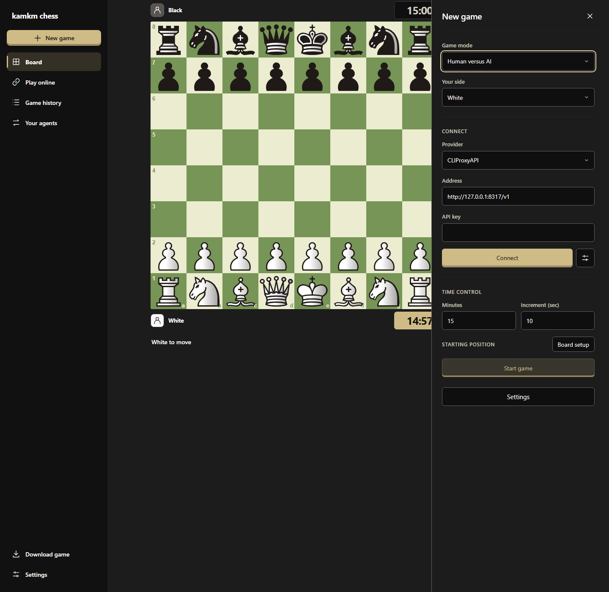
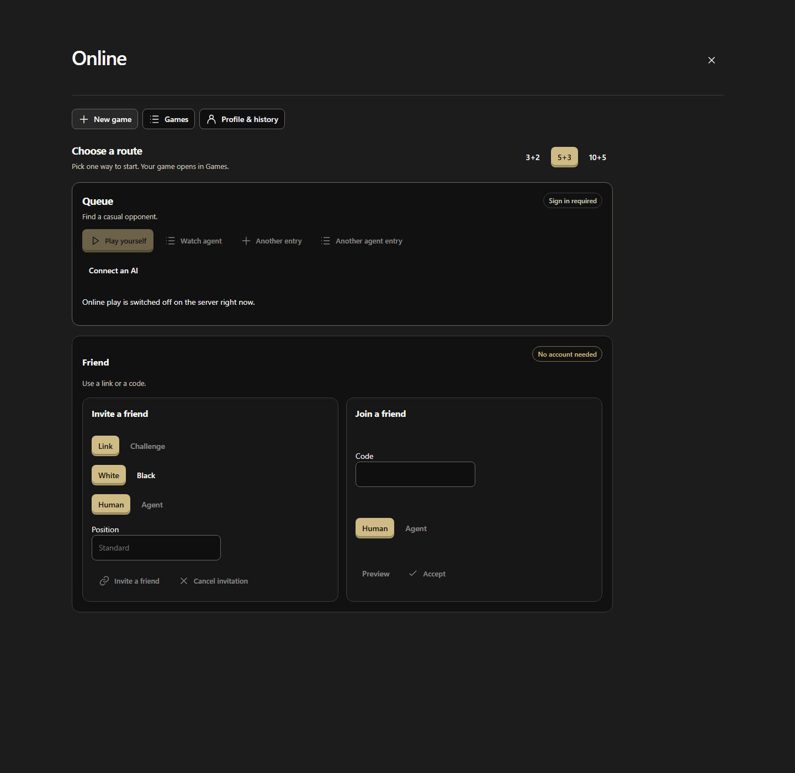

# kamkm chess


Chess against AI models that choose their own moves. The Classic workspace supports local two-player games and AI opponents, with device-local saves, continuous clocks, automatic connection checks, Undo, and request recovery. Model requests stay compact while the full conversation archive is kept.

> [!NOTE]
> Account storage stays off until its deployment is configured and verified.

## Ways to play

**New game** supports human versus human, human versus AI, human versus engine, engine versus engine, engine versus AI, and AI versus AI. Choose each seat independently.

Stockfish Lite and full Stockfish run in your browser. They download and verify themselves when selected, cache the download, and support adjustable thinking time. The picker recommends an engine for your hardware and lists only engines that can run. See [browser engine setup and implementation](docs/browser-engines.md).

After a game ends, choose **Make a video about it** to create a vertical recap in your browser. Stockfish reviews each move, using the full build when this site already has it cached and Lite otherwise. Preview the full game or highlights, adjust the procedural music, flip the board, and export an MP4 or WebM. Analysis checkpoints stay on this device. No LLM or hosted video service is involved. Codec support varies by device; the real-time recording fallback requires a visible tab. See [game video implementation](docs/implementation/chess-video.md).



Agents play through the [remote MCP server](docs/implementation/remote-mcp.md). Choose Agent for White, Black, or both to create a hosted game with separate seat invitations and copy-ready prompts. Play against server Stockfish, a human, or another agent, and share the read-only viewing URL to watch live. Public connection instructions are at `/agents.md`. Page tools advertise the MCP connection instead of local gameplay.

Online play also offers a casual queue for signed-in players and friend games by link or code, no account needed.



## Guides

### Play against an AI model

1. Choose **New game** and pick human versus AI.
2. Connect a provider or proxy, then choose an advertised model.
3. Allow the destination once, set the clock, and start the game.

The app loads the model list and checks the selected model itself. Saved games recheck their model before the next request after a reload. Failed checks block play and offer a retry. The UI never asks for a model ID.

### Play a browser engine

1. Choose **New game** and pick human versus engine, or seat engines on both sides.
2. Pick Stockfish Lite or full Stockfish. The engine downloads and verifies itself, then caches the download.
3. Set the thinking time and start the game.

### Play an agent

1. Choose **New game** and seat an agent on White, Black, or both.
2. Copy each seat's prompt and invitation URL and send it to that agent. Send each player only their own invitation.
3. The agent connects through the remote MCP server. Share the read-only watch URL to follow the game live.

### Invite a friend online

1. Choose **Play online**, then **New game**.
2. Under **Friend**, pick Link or a challenge code, choose your color, and choose a human or agent friend.
3. Send the link or code. Your friend opens **Join a friend**, enters the code, previews the game, and accepts. Friend games need no account; the casual queue asks you to sign in.

### Connect Ollama Cloud

1. Choose **Custom** as the provider.
2. Enter `https://ollama.com/v1` and your API key, connect, and choose an advertised model.

The provider needs no CORS configuration.

> [!NOTE]
> Custom and other remote HTTPS endpoints outside the native provider origins go through this site's `/api/provider-relay`. Deploy the repository to Vercel, or run `pnpm dev` or `pnpm preview`, to serve it. Serving only the contents of `dist/` does not include it.

### Investigate a failed model check

1. Open the browser's developer console and enable Info and Warning messages.
2. Filter for `[model-diagnostic]`, then select the model or click **Try again**.

Entries that share a `diagnosticId` describe one check. `response` records HTTP status, content type, and request ID or retry delay when the browser exposes them. `result` records `failureKind`, the provider error code and message, stream completion, finish reasons, answer and reasoning lengths, and individual contract checks. The `failureKind` values are `credits` for HTTP/provider code 402, `rate-limit` for 429, `output-limit` for a token-length stop, `contract` for a completed reply that failed the required format or markers, `request-failed` for network/read failures and cancellation, and `blocked` for checks stopped locally. For malformed Chat streams, `validationIssues` records the exact rejection reason and zero-based event index. JSON contract checks inspect the accumulated answer independently of stream validity, but selection still requires a complete stream.

Logs stay in the browser console. They omit request bodies, model answers, raw provider metadata, and credential headers, and they redact known request credentials from error messages. A catalog listing alone does not establish generation access or sufficient credits.

## The board

The board uses Lichess's [Chessground](https://github.com/lichess-org/chessground) for animated moves, square-wide mouse and touch dragging, legal destinations, and previous-move highlights.

Use Left/Right to review earlier or later moves, Home for the starting position, and End or **Live** to return to play. Moves in the list are clickable. Reviewing history keeps the live game and clocks running. Entering history or starting another game clears queued input.

During an AI turn, drag or click your pieces to queue any number of premoves. One plays after each reply if it is still legal. An illegal premove cancels the rest of the queue. Choose a promotion piece when queueing a pawn's promotion. Escape, right-click, or **Cancel premove** clears the whole queue.

Right-drag draws green arrows and right-click draws circles. Hold Shift for red, Control for blue, or Alt for amber. Repeat a drawing to remove it, or left-click an empty square to clear all drawings.

## How it works

### Rules and adjudication

Legal moves, king safety, SAN and material checks use Lichess's `chessops` 0.15.1. The app classifies positions synchronously, so normal play creates no proof-search worker or graph. Draws use practical insufficient-material rules, repetition, and the fifty-move rule. Timeouts use side-specific material and a bounded one-ply forced-outcome check. This replaces the former exhaustive dead-position search, so unusual blocked positions can remain playable. Older pending saves migrate automatically and drop their search data. The legacy proof tools remain for archive compatibility and offline fixtures. See [rules research and sources](docs/implementation/lichess-rules-research.md).

Exact position checks run in a Worker and only accept independently checked evidence. Common openings resolve quickly. A difficult position can stay saved with adjudication pending and a continuously running clock. Continue and Stop analysis are explicit actions, and a search cutoff never invents a result.

### What the model sees

Each model move receives the current FEN and side, the starting FEN with SAN move history, remaining clocks and increment, and repeated-position counts when relevant. The model also gets current-turn retry feedback plus its side's latest plan and returned reasoning, and each reply should include a brief plan for the next turn. This rolling memory survives reloads and follows Undo. Raw provider traffic and older thinking stay in the archive. Existing saved games use the same compact requests. See [model input policy](docs/spec/compact-model-input.md).

### Providers and the relay

CLIProxyAPI defaults to `http://127.0.0.1:8317/v1`. OpenAI, OpenRouter, Anthropic, and custom connections are also available, with advanced settings for protocol, authentication, and catalog overrides. Custom endpoints default to a `/models` catalog, and a provider must expose a reachable catalog to appear in the picker. Diagnostics and moves can use provider quota. Saved connections and credentials stay in the browser.

Remote HTTPS endpoints outside the native provider origins go through this site's stateless `/api/provider-relay`, including catalogs, diagnostics, and streamed moves. The relay forwards the connection's API key per request without storing or logging it, and rejects private-network destinations, nonstandard ports, and redirects. Native provider origins and local endpoints connect directly from the browser.

## The interface

The homepage shows the original knight-versus-models artwork over an animated black dither, with a responsive sidebar and an interactive opening preview. Choose **Play against AI** to open the playable workspace at `/play`. Landing and gameplay share six themes and a saved light, dark or system appearance, chosen from the landing navigation or the game settings. They load separate styles and entry chunks. See [landing design notes](docs/design/landing.md) for the artwork, Quartz components and preview scope.

Screens contain at most 20 words of interface copy, and engine screens at most 10. Chess coordinates, notation, clocks, and numeric values count as game data. A scrollable moves sidebar pairs White and Black moves, follows the selected move, and lets you review any position without changing live play. It sits below the board on phones. Coordinate entry, appearance, and position editing open as focused screens. Conversation pages show eight words at a time. Settings can download the complete match archive with full messages, reasoning, usage, and undone lines. Icons keep accessible names and hover labels, and keyboard history shortcuts remain available.

## Local development

> [!IMPORTANT]
> Use Node **24.22.0** and pnpm **12.14.0**. `.node-version` pins the Node runtime and `packageManager` pins pnpm.

Run these commands at the repository root in PowerShell or another Corepack-compatible shell:

```sh
pnpm install --frozen-lockfile
pnpm dev
```

Vite prints the local URL. The development server binds to loopback. Keep `pnpm dev` running while you play. For the production build:

```sh
pnpm check
pnpm preview
```

The browser tests can start a temporary preview at port 5175 and stop it when they finish. A page already open at that address cannot reload assets after the server stops. For a persistent production preview, run `pnpm build` followed by `pnpm preview --port 5175 --strictPort` and leave that process running.

Browser files are in `dist/`. The build includes the application license and production dependency notices. Vercel hosts the frontend. The Go API and private PostgreSQL database run on the server. See [API contracts](docs/architecture/go-api.md) and the [deployment runbook](deploy/README.md). Guest play needs no hosting or account service, and running the app locally does not provision infrastructure.

## Checks

| Command | Purpose |
| --- | --- |
| `corepack pnpm typecheck` | Strict TypeScript checks for browser code, tools and fixtures. |
| `corepack pnpm lint` | ESLint, TypeScript and React Hooks/refresh checks; warnings fail. |
| `corepack pnpm test` | Run deterministic fixtures once. |
| `corepack pnpm test -- src/rules/rules.test.ts` | Run the strict rules fixtures. |
| `corepack pnpm test:watch` | Rerun selected fixtures during development. |
| `corepack pnpm build` | Typecheck, compile static assets and collect runtime license notices. |
| `corepack pnpm check` | Lint, full fixture suite and production build. |
| `pnpm test:browser` | Run Chromium playthroughs against the built app with an offline provider fixture. Run `pnpm build` first and install Chromium with `pnpm exec playwright install chromium`. |
| `node --test scripts/release/readiness-audit.test.mjs` | Verify the offline release audit and synthetic secret scanner. |
| `node scripts/release/readiness-audit.mjs` | Inspect the actual distribution and hosting files for release blockers. |
| `node --test deploy/runtime-grants.test.mjs deploy/runtime-grants-sequence.test.mjs deploy/runtime-grants-provision.test.mjs deploy/runtime-grants-probe.test.mjs deploy/verify-compose-config.test.mjs scripts/online/cohort-enforcement.test.mjs scripts/online/cohort-commitment.test.mjs scripts/online/friend-cohort-run.test.mjs scripts/online/fixture-client.test.mjs scripts/online/online-ops.test.mjs` | Verify the online operations tooling. |
| `pnpm run grants:check` | Compare the least-privilege runtime grant policy with the migrations and the writer's statements. |
| `pnpm run grants:provision` | Compare the grants the real provisioning routine applies with the reviewed policy. |
| `pnpm run grants:probe` | Execute the runtime role grants against a real local PostgreSQL and probe what the role can do. |
| `pnpm run online:wiring` | Prove the server, not the browser, owns the online feature switches. |
| `pnpm run online:backup` | Audit the backup coverage and the removal ledger of a restore. |
| `pnpm run online:fixture` | Start the real service composition on loopback with an isolated schema and its own signing key. |
| `pnpm run online:integration` | Run the local integration suite against a real database and record the evidence. |
| `pnpm run online:load` | Run the synthetic local load harness and write the measurement report. |
| `pnpm run online:evidence` | Rebuild the evidence ledger from the recorded evidence. |
| `pnpm run online:gates` | Evaluate the friend release gate. |
| `pnpm run online:packet` | Print the reversible friend rollout packet. |
| `go test ./backend/... ./cmd/...` | Compile the Go API and run its offline fixtures. PostgreSQL integration fixtures require a separate local database. |
| `go vet ./backend/... ./cmd/...` | Check production Go source for common errors. |

Vitest runs offline fixtures for strict rules, clock calculations, proof checking and search, archive validation, local storage, provider connections and protocols, and serialized controller decisions. A missing fixture suite fails the test command. Fixture coverage does not certify native browser or product acceptance. See [the fixture guide](tests/README.md), [KHA-29 controller evidence](docs/implementation/KHA-29-controller-evidence.md), [KHA-31 proof-search evidence](docs/implementation/KHA-31-evidence.md), [KHA-34 connection API](docs/implementation/KHA-34-api.md) and [evidence](docs/implementation/KHA-34-evidence.md), and [KHA-35 protocol-core evidence](docs/implementation/KHA-35-evidence.md).

The browser suite verifies a full legal game through checkmate and reload, compact requests with archived plans, Black-side starts and practice, Stop/Retry, Undo retention, and another game with the same model. It also covers queued model changes and automatic connection rechecks after reload. Browser and Go CI run automatically for pull requests and `main`. Native screen readers, real provider routes, and hosted account storage still need separate acceptance runs.

## Implementation references

- [Module responsibilities and authority](docs/architecture/modules.md)
- [KHA-29 serialized controller evidence](docs/implementation/KHA-29-controller-evidence.md)
- [KHA-32 pending adjudication API and evidence](docs/implementation/KHA-32-pending-adjudication.md)
- [KHA-33 guest lifecycle, Undo and practice evidence](docs/implementation/KHA-33-lifecycle.md)
- [KHA-31 proof-search evidence](docs/implementation/KHA-31-evidence.md)
- [KHA-34 connection API](docs/implementation/KHA-34-api.md) and [evidence](docs/implementation/KHA-34-evidence.md)
- [KHA-35 protocol-core evidence](docs/implementation/KHA-35-evidence.md)
- [Durable model request and conversation API](docs/implementation/KHA-37-api.md)
- [Opponent catalogs and diagnostic API](docs/implementation/KHA-38-api.md)
- [Controller model handoffs](docs/implementation/KHA-38-controller-api.md)
- [Optional Clerk account API](docs/implementation/KHA-42-api.md) and [cloud sync API](docs/implementation/KHA-43-api.md)
- [Online participant authorization](docs/architecture/online-authorization.md), including guest seat credentials and identity fencing. Online invitations, transport and board integration continue in their dependent tickets.
- [Encrypted backups and local restore rehearsal](docs/implementation/MVP-operations.md)
- [Exact position checks and resource limits](docs/implementation/MVP-position-checks.md)
- [Go API and PostgreSQL storage](docs/architecture/go-api.md)
- [Dependency and artwork inventory](docs/dependency-notices.md)
- [Approved specification](docs/spec/mvp-handoff.md) and [acceptance cases](docs/spec/mvp-acceptance.json)
- [Implementation roadmap](docs/spec/implementation-plan.md) and [canonical Linear tracker](docs/agents/issue-tracker.md)

The owner selected the Classic workspace in [the KHA-12 Linear issue](https://linear.app/kamkm/issue/KHA-12/validate-the-connection-and-chess-match-interface). The disposable prototype source and captures are not in this repository. That decision does not pass native screen-reader acceptance. See the MVP handoff for the remaining criteria.

## Configuration and distribution

Guest play needs no build environment variables. You configure provider profiles and credentials in the browser. Vite's general environment-prefix exposure is off. Only three public build settings are allowlisted: `KAMKM_PUBLIC_ACCOUNTS_ENABLED`, `KAMKM_PUBLIC_CLERK_PUBLISHABLE_KEY`, and `KAMKM_PUBLIC_API_BASE_URL`. Invalid publishable keys and insecure remote API origins cannot enable accounts. Server secrets stay in the server process environment; see `.env.example`.

> [!WARNING]
> Never put private keys in browser source, `public/`, or any public setting.

Vercel's CSP permits direct HTTPS and loopback provider connections, the deployed Clerk scripts and account frames, and Clerk's inline styles. Application Workers stay on the application origin. Browser CORS and local-network permission rules still apply. The server API requires a verified Clerk session and configured origins. Clerk email sign-in is configured; Google sign-in needs a production OAuth client. The [deployment runbook](deploy/README.md) records the server services, private credentials, backups, and verification.

Run `pnpm install --frozen-lockfile` after checkout. Use exact package versions and review changes to `pnpm-lock.yaml`. Recheck notices and bundle contents when dependencies or assets change. Research and experiment dependencies stay separate from the production root package.

## License

Copyright (c) 2026 kamkmchess contributors. This project is free software under the [GNU General Public License](LICENSE), version 3 or, at your option, any later version (`GPL-3.0-or-later`). It comes without any warranty, including implied warranties of merchantability or fitness for a particular purpose. The owner adopted this license on 2026-10-18.

Third-party code and artwork keep their own licenses and attribution. The [previous MIT notice](docs/licenses/kamkmchess-MIT.txt) remains for previously published kamkmchess code, and earlier MIT grants stay valid. The current project and its combined browser distribution use GPL-3.0-or-later.
